<div align="center">

# 💊 InteraX

**From a photo of a pill box to a doctor-ready, interaction-checked medication list in about a minute.**

Built for the **PillGaze** challenge at Rakathon.

### [🚀 Live demo: interax.hutnan.dev](https://interax.hutnan.dev/)

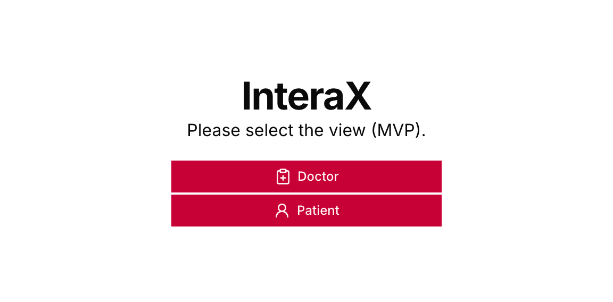

</div>

---

## The problem

Taking a patient's pharmacological history is slow and error-prone. Patients turn up with
pill boxes, handwritten notes and half-remembered chemotherapy regimens. A clinician has to
turn all of that into a structured list and then check it for dangerous drug-drug
interactions, which is especially hard in oncology.

InteraX does it in three steps:

1. **Patients** scan their medication boxes or handwritten lists, or just dictate them, from a phone.
2. They share the result with a **6-digit PIN** that expires after an hour. No account and no personal data are needed.
3. **Doctors** enter the PIN and get an editable prescription table mapped to SÚKL active
   substances, the regimen broken down into its components, and a ranked list of interactions with
   explanations. They can push all of it to a FHIR repository.

---

## 📱 Patient app

The patient side is anonymous and mobile-first. Forms are kept only in the browser's local storage until the patient chooses to share them.

### Scan a box: the pharmacist's handwriting is read too

One vision-LLM call works out whether the photo shows a **medication package** or a **handwritten list**.
It reads the drug name plus any dosing the pharmacist wrote on the box (`1-0-1` here).
The drug is then matched against the Czech SÚKL database to find its active substances (Dithiaden → bisulepin).

<table>
  <tr>
    <th>Photo taken with a phone</th>
    <th>Result in the app</th>
  </tr>
  <tr>
    <td align="center" valign="middle">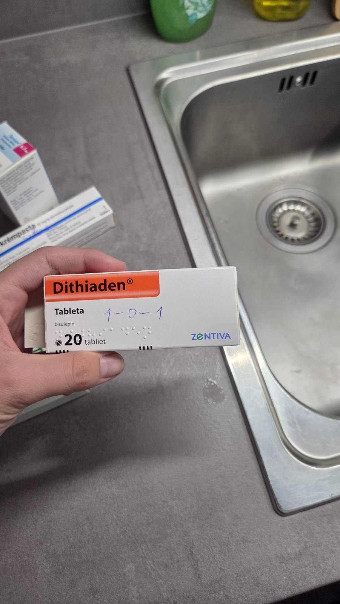</td>
    <td align="center">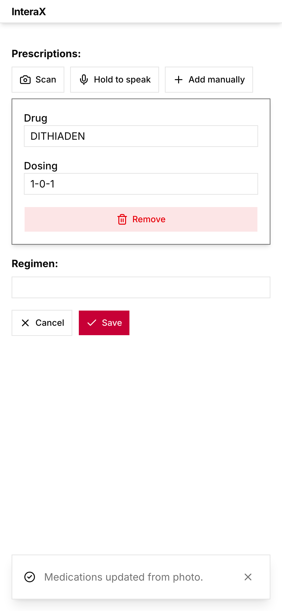</td>
  </tr>
</table>

### Hold to speak

Patients can simply say what they take, in Czech. Speech is transcribed **locally with Whisper**,
then an LLM extracts each drug and how it's taken. New drugs are added to the list. For drugs already on it, only the dosing is updated.
In the screenshot, the scanned Dithiaden stays on the list and Prestarium, Warfarin and Godasal are added.

<table>
  <tr>
    <th>Recording</th>
    <th>"Prestarium deset miligramů, jednu ráno. Warfarin tři miligramy, jednu večer. A Godasal sto, jednu ráno."</th>
  </tr>
  <tr>
    <td align="center" valign="top">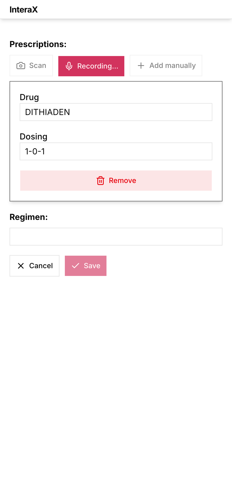</td>
    <td align="center" valign="top">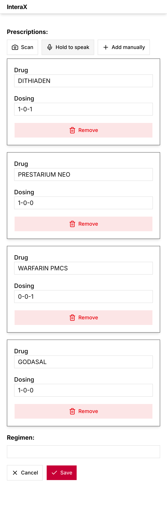</td>
  </tr>
</table>

### Oncology regimens and the PIN handoff

The regimen field autocompletes from **5,878 oncology regimens** (FOLFOX, FOLFIRI, R-CHOP, …).
When the form is ready, **Get code** issues a 6-digit PIN. It is valid for one hour, and the patient can revoke it at any time.

<table>
  <tr>
    <th>Regimen autocomplete</th>
    <th>Share with a PIN</th>
  </tr>
  <tr>
    <td align="center" valign="top">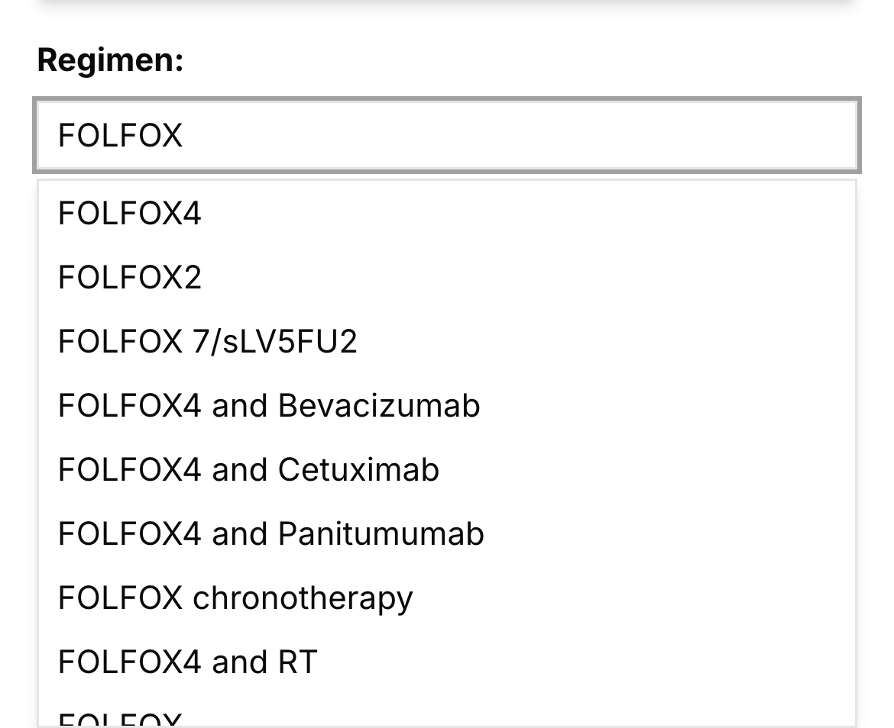</td>
    <td align="center" valign="top">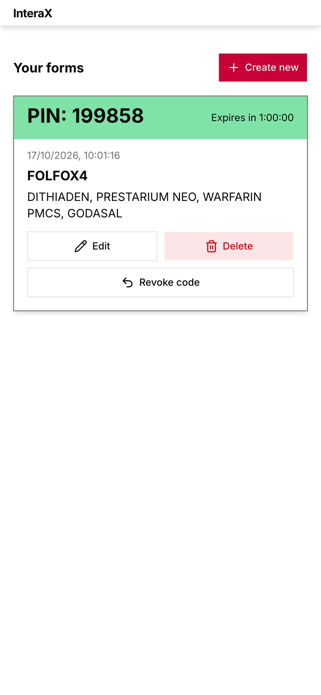</td>
  </tr>
</table>

---

## 🩺 Doctor dashboard

<table>
  <tr>
    <th>Sign in</th>
    <th>Open a patient's form by PIN</th>
  </tr>
  <tr>
    <td align="center">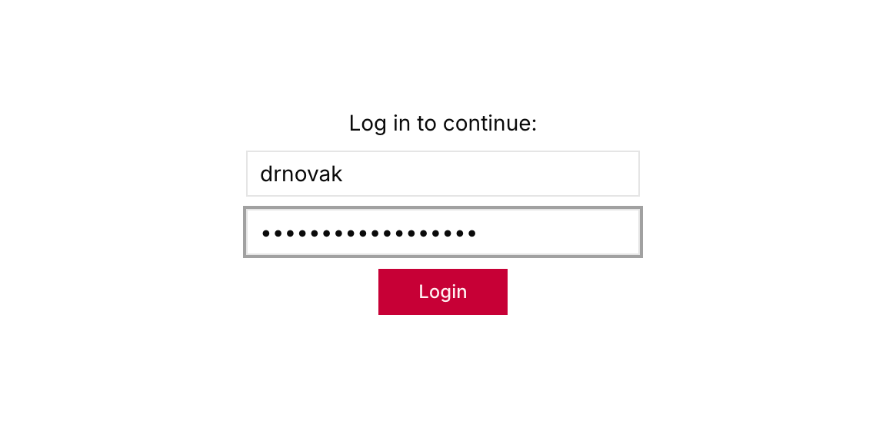</td>
    <td align="center">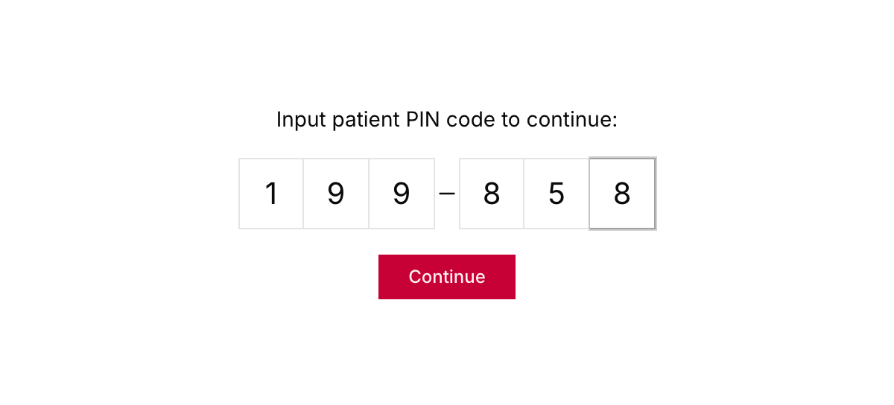</td>
  </tr>
</table>

### Review and edit

Prescriptions and regimens appear as editable tables. **Auto-fill** looks up the active substances
in SÚKL, and **Apply components** breaks a regimen into its drugs. In the screenshot, FOLFOX4 becomes Fluorouracil, Leucovorin and
Oxaliplatin.

<p align="center">
  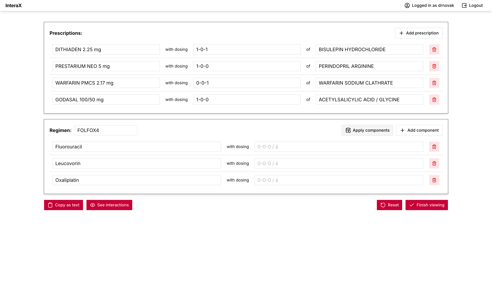
</p>

### Interaction screening

The patient's drugs and the regimen components are checked against each other. A severity slider
(Unknown → Minor → Moderate → Major → Contraindicated) hides the less important findings. Hovering an
interaction highlights the rows involved. The findings can be copied as text, in a verbose or compact format.

<p align="center">
  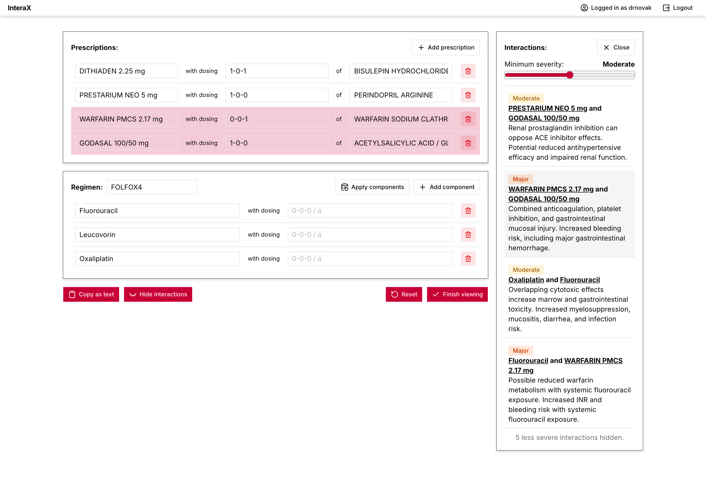
</p>

### Finish: send to FHIR

When the doctor finishes, the reviewed medications and the checked interactions can be sent to the FHIR R4
repository as `MedicationStatement` and `DetectedIssue` resources. No personal data is included.

<p align="center">
  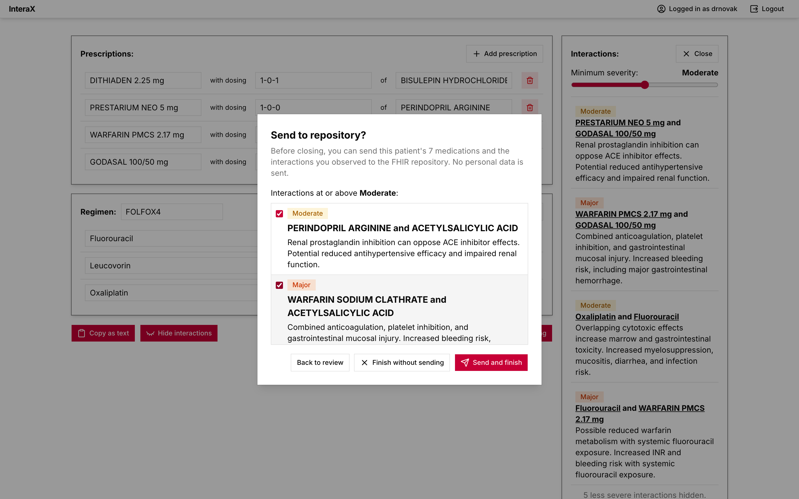
</p>

---

## ⚙️ How it works

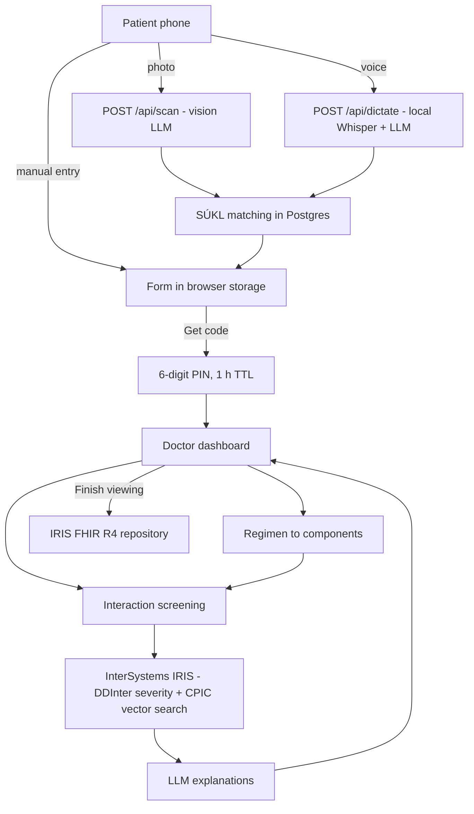

| Piece | What it does |
| --- | --- |
| **Scan** (`POST /api/scan`) | One call to a remote OpenAI-compatible vision model. It classifies the photo as package or handwritten list and extracts names and dosing, including a pharmacist's handwriting on the box. |
| **Dictation** (`POST /api/dictate`) | [faster-whisper](https://github.com/SYSTRAN/faster-whisper) (`small`, CPU int8, Czech) transcribes locally, then a text-only LLM call turns the transcript into a medication list. |
| **SÚKL matching** | Fuzzy name matching against the SÚKL DLP tables (medications, their composition and active substances) to find the English INN of every active component. |
| **Dosing notation** | Normalised to `a-b-c` (morning-noon-evening), `k*` (as needed) and `á n dní` (every *n* days). |
| **Interactions** | If `IRIS_HOST` is set, the InterSystems IRIS pipeline normalises names to SÚKL/INN/ATC and pulls DDInter severity rows. It also retrieves CPIC pharmacogenomic guidance by vector search (`all-MiniLM-L6-v2`, `VECTOR_DOT_PRODUCT`), and an LLM writes the explanations. Without IRIS, it falls back to the RxLabel API. |
| **PIN sessions** | Short-lived, revocable 6-digit codes. Doctors use server-side sessions with an HttpOnly cookie and CSRF protection. |

### Tech stack

- **Frontend:** Next.js 16, React 19, Tailwind CSS, Base UI
- **Backend:** Python, FastAPI, faster-whisper
- **Data:** PostgreSQL 17 (SÚKL DLP, oncology regimens), InterSystems IRIS (vector search + FHIR R4)
- **AI:** vision and text LLMs through an OpenAI-compatible API, Whisper for speech
- **Infra:** Docker Compose locally, Azure Container Apps in production

---

## Project Structure

- **[`app/`](./app):** Next.js / React frontend containing patient upload/PIN views and clinician dashboard.
- **[`server/`](./server):** Python backend (FastAPI) handling ingestion, parsing, interaction screening, and PIN sessions.
- **[`database/`](./database):** Postgres image with the drug vocabularies loaded from CSV.
- **[`deploy/`](./deploy):** Azure Container Apps deployment script.
- **[`experiments/`](./experiments):** Research and prototyping workspace for OCR models, prompts, and evaluation datasets.
- **[`docs/screenshots/`](./docs/screenshots):** The screenshots above and the Playwright script that captures them.

## Running locally

```sh
docker compose up -d --build
docker compose exec server python -m app.manage create-user <name> --role clinician
```

The app is on <http://localhost:3000> (patients at `/patient`, clinicians at `/doctor`). The
browser only talks to the Next.js app, which proxies `/api/*` to the server, so the session
cookie is first-party. The API docs are on <http://localhost:8080/docs>.

Doctor accounts are created only with `app.manage create-user`; the patient side needs no account.

### Regenerating the screenshots

The screenshots are taken from a running instance (by default the live site) with Playwright.
The script fakes the microphone with a Czech `say -v Zuzana` recording, so it needs macOS. When it
finishes, it revokes the PIN it created and never sends anything to FHIR.

```sh
pip install playwright && playwright install chromium
INTERAX_DOCTOR_USER=<user> INTERAX_DOCTOR_PASSWORD=<password> \
    python docs/screenshots/capture.py [--url http://localhost:3000] [--headed]
```

## Deploying to Azure

```fish
fish deploy/azure.fish
```

Creates/updates three Container Apps: `interax` (the public web app), `interax-server`
(internal only) and `interax-db` (internal only). See the script header for the `.env`
settings it reads. The public URL is `https://interax.<environment-domain>`.

<details>
<summary><b>A nicer URL (custom domain)</b></summary>

The `<random>.swedencentral.azurecontainerapps.io` part comes from the Container Apps
environment and can't be changed; only the first label (the app name, `interax`) can.
For a real name you need a domain (~10 €/year, e.g. from Cloudflare or Porkbun; Azure
doesn't sell domains through this subscription). Container Apps then serves it with a free,
auto-renewing managed certificate:

```fish
set FQDN (az containerapp show -n interax -g rg-team89 --query properties.configuration.ingress.fqdn -o tsv)
az containerapp show -n interax -g rg-team89 --query properties.customDomainVerificationId -o tsv
# At the DNS provider, for app.example.com:
#   CNAME  app          -> $FQDN
#   TXT    asuid.app    -> <the verification id above>
az containerapp hostname add  -n interax -g rg-team89 --hostname app.example.com
az containerapp hostname bind -n interax -g rg-team89 --hostname app.example.com \
    --environment aca-team89-sandbox --validation-method CNAME
```

For an apex domain (`example.com`), use an A record to the environment's static IP and
`--validation-method HTTP` instead. The hackathon sandbox may forbid custom domains or
managed certificates by policy; if `hostname bind` is denied, that's why. Free subdomain
services (DuckDNS, etc.) usually can't host the `asuid` TXT record, so they don't work here.

</details>
