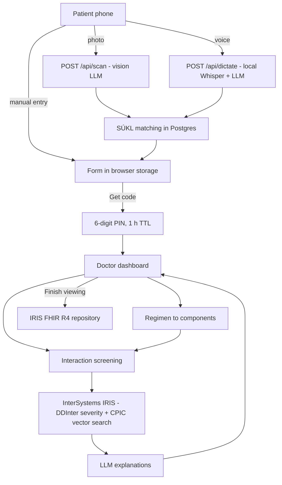
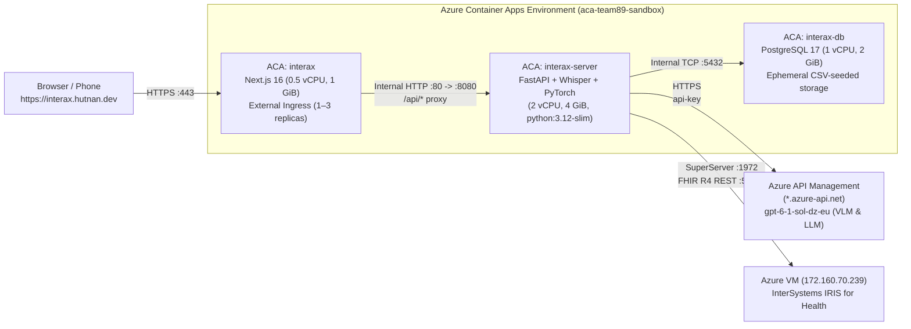

<div align="center">

# 💊 InteraX

**From a photo of a pill box to a doctor-ready, interaction-checked medication list in about a minute.**

*The application is fully accessible according to WAI-ARIA standards.*

Built for the **PillGaze** challenge at Rakathon.

### [🚀 Live demo: interax.hutnan.dev](https://interax.hutnan.dev/)


</div>

---

## The problem

Taking a patient's pharmacological history is slow and error-prone. Patients turn up with
pill boxes, handwritten notes and half-remembered chemotherapy regimens. A clinician has to
turn all of that into a structured list and then check it for dangerous drug-drug
interactions, which is especially hard in oncology.

InteraX does it in three steps:

1. **Patients** scan their medication boxes or handwritten lists, or just dictate them, from a phone.
2. They share the result with a **6-digit PIN** that expires after an hour. No account and no personal data are needed.
3. **Doctors** enter the PIN and get an editable prescription table mapped to SÚKL active
   substances, the regimen broken down into its components, and a ranked list of interactions with
   explanations. They can push all of it to a FHIR repository.

---

## 📱 Patient app

The patient side is anonymous and mobile-first. Forms are kept only in the browser's local storage until the patient chooses to share them.

### Scan a box: the pharmacist's handwriting is read too

One vision-LLM call works out whether the photo shows a **medication package** or a **handwritten list**.
It reads the drug name plus any dosing the pharmacist wrote on the box (`1-0-1` here).
The drug is then matched against the Czech SÚKL database to find its active substances (Dithiaden → bisulepin).

<table>
  <tr>
    <th>Photo taken with a phone</th>
    <th>Result in the app</th>
  </tr>
  <tr>
    <td align="center" valign="middle"></td>
    <td align="center"></td>
  </tr>
</table>

### Hold to speak

Patients can simply say what they take, in Czech. Speech is transcribed **locally with Whisper**,
then an LLM extracts each drug and how it's taken. New drugs are added to the list. For drugs already on it, only the dosing is updated.
In the screenshot, the scanned Dithiaden stays on the list and Prestarium, Warfarin and Godasal are added.

<table>
  <tr>
    <th>Recording</th>
    <th>"Prestarium deset miligramů, jednu ráno. Warfarin tři miligramy, jednu večer. A Godasal sto, jednu ráno."</th>
  </tr>
  <tr>
    <td align="center" valign="top"></td>
    <td align="center" valign="top"></td>
  </tr>
</table>

### Oncology regimens and the PIN handoff

The regimen field autocompletes from **5,878 oncology regimens** (FOLFOX, FOLFIRI, R-CHOP, …).
When the form is ready, **Get code** issues a 6-digit PIN. It is valid for one hour, and the patient can revoke it at any time.

<table>
  <tr>
    <th>Regimen autocomplete</th>
    <th>Share with a PIN</th>
  </tr>
  <tr>
    <td align="center" valign="top"></td>
    <td align="center" valign="top"></td>
  </tr>
</table>

---

## 🩺 Doctor dashboard

<table>
  <tr>
    <th>Sign in</th>
    <th>Open a patient's form by PIN</th>
  </tr>
  <tr>
    <td align="center"></td>
    <td align="center"></td>
  </tr>
</table>

### Review and edit

Prescriptions and regimens appear as editable tables. **Auto-fill** looks up the active substances
in SÚKL, and **Apply components** breaks a regimen into its drugs. In the screenshot, FOLFOX4 becomes Fluorouracil, Leucovorin and
Oxaliplatin.

<p align="center">
  
</p>

### Interaction screening

The patient's drugs and the regimen components are checked against each other. A severity slider
(Unknown → Minor → Moderate → Major → Contraindicated) hides the less important findings. Hovering an
interaction highlights the rows involved. The findings can be copied as text, in a verbose or compact format.

<p align="center">
  
</p>

### Finish: send to FHIR

When the doctor finishes, the reviewed medications and the checked interactions can be sent to the FHIR R4
repository as `MedicationStatement` and `DetectedIssue` resources. No personal data is included.

<p align="center">
  
</p>

---

## ⚙️ How it works



| Piece | What it does |
| --- | --- |
| **Scan** (`POST /api/scan`) | One call to a remote OpenAI-compatible vision model. It classifies the photo as package or handwritten list and extracts names and dosing, including a pharmacist's handwriting on the box. |
| **Dictation** (`POST /api/dictate`) | [faster-whisper](https://github.com/SYSTRAN/faster-whisper) (`small`, CPU int8, Czech) transcribes locally, then a text-only LLM call turns the transcript into a medication list. |
| **SÚKL matching** | Fuzzy name matching against the SÚKL DLP tables (medications, their composition and active substances) to find the English INN of every active component. |
| **Dosing notation** | Normalised to `a-b-c` (morning-noon-evening), `k*` (as needed) and `á n dní` (every *n* days). |
| **Interactions** | If `IRIS_HOST` is set, the InterSystems IRIS pipeline normalises names to SÚKL/INN/ATC and pulls DDInter severity rows. It also retrieves CPIC pharmacogenomic guidance by vector search (`all-MiniLM-L6-v2`, `VECTOR_DOT_PRODUCT`), and an LLM writes the explanations. Without IRIS, it falls back to the RxLabel API. |
| **PIN sessions** | Short-lived, revocable 6-digit codes. Doctors use server-side sessions with an HttpOnly cookie and CSRF protection. |

### Data Sources
The processing pipeline relies on the following external databases and ontologies for clinical entity resolution and interaction screening:
- **[SÚKL DLP](https://opendata.sukl.cz/?q=katalog/databaze-lecivych-pripravku-dlp)**: Utilized for matching extracted drug names to canonical active substances.
- **[HemOnc Ontology (Athena)](https://athena.ohdsi.org/search-terms/start)**: Downloaded and integrated for referencing oncology regimens and breaking them down into respective component drugs.
- **[DDInter](https://ddinter.scbdd.com/download/)**: Queried to identify and rank adverse drug-drug interactions.
- **[CPIC Guidelines](https://www.clinpgx.org/cpic/guidelines)**: Referenced via vector search to explain severe adverse interactions on a physiological and pharmacogenomic level.

### Tech stack

- **Frontend:** Next.js 16, React 19, Tailwind CSS, Base UI
- **Backend:** Python, FastAPI, faster-whisper
- **Data:** PostgreSQL 17 (SÚKL DLP, oncology regimens), InterSystems IRIS (vector search + FHIR R4)
- **AI:** vision and text LLMs through an OpenAI-compatible API, Whisper for speech
- **Infra:** Docker Compose locally, Azure Container Apps in production

---

## 🏥 InterSystems IRIS for Health (SQL, Vector Search & HL7 FHIR R4)

InteraX uses **InterSystems IRIS for Health** (`USER` namespace) as a unified, multi-model clinical data platform combining relational SQL, native in-database vector similarity search, and an HL7 FHIR R4 repository inside a single engine.

### 1. Programmatic HealthShare & FHIR R4 Provisioning (ObjectScript)
Instead of relying on manual UI setup, we automated the activation of the `USER` namespace and installation of the FHIR R4 server directly from Python via `intersystems-irispython`'s native ObjectScript binding (`iris.connect()`):
- Enabled the HealthShare Foundation namespace via `HS.HC.Util.Installer.InstallFoundation("USER")`.
- Provisioned the FHIR R4 endpoint (`/csp/healthshare/fhir/r4`) with core package `hl7.fhir.r4.core@4.0.1` via `HS.FHIRServer.Installer.InstallInstance`, automatically generating the internal resource storage table (`HSFHIR_X0001_R.Rsrc`), version history (`HSFHIR_X0001_V.RsrcVer`), and indexed search tables (`HSFHIR_X0001_S_MedicationStatement`, `HSFHIR_X0001_S_DetectedIssue`).

### 2. Proprietary IRIS SQL & Native `VECTOR(DOUBLE, 384)` Search
The production RAG module in [`server/rag/`](./server/rag) ([`config.py`](./server/rag/config.py), [`iris_store.py`](./server/rag/iris_store.py), [`adjudicator.py`](./server/rag/adjudicator.py), [`fhir.py`](./server/rag/fhir.py), [`pipeline.py`](./server/rag/pipeline.py)) executes a 4-stage pipeline over IRIS SuperServer port `1972`:

| IRIS Table | Rows | Proprietary Features & Role in Pipeline |
| --- | --- | --- |
| `ClinicalData.SuklRegistry` | **69,848** | Czech national drug registry (7-digit SÚKL code, brand name, English INN active substance, strength, WHO ATC code). Uses IRIS's proprietary **`%STARTSWITH`** prefix predicate and salt-stripping normalization (`citrate`, `hydrochloride`, `clathrate`, etc.) with a cached RapidFuzz `WRatio` fallback. |
| `ClinicalData.Interactions` | **160,237** | Deterministic DDInter 2.0 drug-drug interaction matrix across all severity levels (`Major`, `Moderate`, `Minor`, `Unknown`). Queried pairwise via IRIS SQL so the LLM never guesses whether an interaction exists or what its severity is. |
| `ClinicalKnowledge.CpicVectors` | **776** | Peer-reviewed CPIC pharmacogenomic guideline chunks stored with IRIS's native **`VECTOR(DOUBLE, 384)`** column type (`sentence-transformers/all-MiniLM-L6-v2`). Queried in-database via **`VECTOR_DOT_PRODUCT(Embedding, TO_VECTOR(?, DOUBLE, 384))`** with adaptive top-$k$ retrieval ($k=2$ chunks per substance for $\le 3$ drugs; $k=1$ for $>3$ drugs). |

### 3. HL7 FHIR R4 Persistence (`POST /api/repo`)
When the clinician clicks **Finish and send**, [`upload_to_fhir()`](./server/rag/fhir.py) persists the reviewed session to `http://<IRIS_HOST>:52773/csp/healthshare/fhir/r4` using content negotiation (`Content-Type: application/fhir+json`, `Prefer: return=representation`):
- **Zero-PII Session Binding:** Generates an ephemeral UUID (`Patient/<session_uuid>`) shared across all resources created in that consultation.
- **`MedicationStatement` Resources:** Each drug is coded with dual `CodeableConcept` entries—the 7-digit SÚKL DLP code (`https://sukl.cz/terminology/CodeSystem/dlp`) and the WHO ATC code (`http://www.whocc.no/atc`)—plus structured dosage text (`mg | usage`).
- **`DetectedIssue` Resources:** Each confirmed interaction is stored with `status: "final"`, HL7 `v3-ActCode` `DRG` (*Drug Interaction Alert*), mapped FHIR severity (`high | moderate | low`), and `.implicated` references pointing to the exact `MedicationStatement/<id>` resources involved.

### 4. IRIS ETL & Verification Scripts
- **[`experiments/rag-interactions/01_preprocess_and_ingest.py`](./experiments/rag-interactions/01_preprocess_and_ingest.py):** Parses SÚKL DLP CSVs, DDInter interaction tables, and CPIC guidelines, embeds chunks with `all-MiniLM-L6-v2`, and bulk-loads them into IRIS.
- **[`experiments/rag-interactions/02_iris_schema_and_verify.py`](./experiments/rag-interactions/02_iris_schema_and_verify.py):** Creates the IRIS SQL & `VECTOR(DOUBLE, 384)` schemas and validates row counts and vector dot-product queries.
- **[`experiments/rag-interactions/03_pipeline.py`](./experiments/rag-interactions/03_pipeline.py) & [`04_demo_verify.py`](./experiments/rag-interactions/04_demo_verify.py):** Standalone end-to-end verification of the IRIS SQL + Vector + APIM + FHIR R4 pipeline.

---

## ☁️ Microsoft Azure Architecture, Containers & Automation

Production is deployed on **Microsoft Azure** (`swedencentral`, resource group `rg-team89`) using **Azure Container Apps**, **Azure Container Registry (ACR)**, an **Azure VM** for InterSystems IRIS, and **Azure API Management (APIM)** for LLM/VLM inference.



### 1. Zero-Trust Container Apps Topology
- **`interax` (Next.js 16 Web App — External Ingress):** The **only** container exposed to the public internet. Stateless and configured to auto-scale (`1..3` replicas). Rewrites `/api/*` requests over the internal Container Apps virtual network to `http://interax-server`, ensuring all clinician session cookies remain strictly first-party (`HttpOnly`, `SameSite`, CSRF-protected) with no cross-origin exposure.
- **`interax-server` (FastAPI Backend — Internal HTTP Ingress):** Pinned to `python:3.12-slim` (required by the native `intersystems-irispython` wheel ABI) and provisioned with **2 vCPUs and 4 GiB RAM** to run CPU `int8` `faster-whisper` speech transcription and the `all-MiniLM-L6-v2` PyTorch embedding model in-memory. Configured with `--type internal --allow-insecure true` so internal `POST` requests from Next.js are never dropped by HTTP-to-HTTPS redirects.
- **`interax-db` (PostgreSQL 17 — Internal TCP Ingress):** Exposed exclusively on internal TCP port `5432`. Intentionally runs **without a persistent volume**: on container boot, it seeds the read-only SÚKL DLP and HemOnc oncology regimen vocabularies from bundled CSVs, guaranteeing that ephemeral PIN uploads and sessions cannot accumulate on disk.
- **Azure API Management (APIM) AI Gateway:** All vision OCR (`/api/scan`), dictation structuring (`/api/dictate`), and clinical RAG adjudication (`/api/interactions`) calls traverse an Azure APIM gateway (`UNSLOTH_BASE_URL` on `*.azure-api.net`) backing `gpt-6-1-sol-dz-eu`, enforcing strict JSON outputs (`response_format={"type": "json_object"}`) and bounded 10-word clinical explanations.

### 2. Idempotent Deployment & Content-Addressed ACR Builds (`deploy/azure.fish`)
The entire cloud stack is provisioned and updated with a single idempotent Fish script:

```fish
fish deploy/azure.fish
```

Key automation mechanisms in [`deploy/azure.fish`](./deploy/azure.fish):
- **Content-Addressed Image Tagging (`context_hash`):** Computes a deterministic 12-character double-SHA256 digest over all tracked files in `./database`, `./server`, and `./app` (plus build arguments such as `API_INTERNAL_URL`), excluding `.venv`, `node_modules`, `.next`, and `.env`.
- **Architecture-Independent Cloud Builds (`build_if_missing`):** Queries `az acr repository show` against Azure Container Registry (`acrteam89interax`). If an image tag (`interax-db:<hash>`, `interax-server:<hash>`, `interax-web:<hash>`) already exists in ACR, the build is skipped completely; otherwise `az acr build --platform linux/amd64` builds the image remotely in Azure—allowing seamless deploys from ARM64 (Apple Silicon) or x86_64 machines without local Docker overhead.
- **Selective Database Restart:** `interax-db` is only updated and restarted when its `DB_TAG` hash changes, avoiding unnecessary multi-minute CSV reloads on code-only backend/frontend deployments, while reusing the existing `pg-password` secret from Azure.
- **Managed Secrets (`secretref:`):** Sensitive `.env` values (`DATABASE_URL`, `UNSLOTH_API_KEY`, `RXLABEL_API_KEY`, `IRIS_PASSWORD`, `BOOTSTRAP_ADMIN_PASSWORD`) are stored as encrypted Container App secrets and mounted via `secretref:`, with timestamped revision suffixes (`--revision-suffix r$STAMP`) forcing clean rollouts whenever secrets change.

---

## Project Structure

- **[`app/`](./app):** Next.js / React frontend containing patient upload/PIN views and clinician dashboard.
- **[`server/`](./server):** Python backend (FastAPI) handling ingestion, parsing, interaction screening, and PIN sessions (`server/rag/` contains the modular InterSystems IRIS RAG & FHIR R4 pipeline).
- **[`database/`](./database):** Postgres image with the drug vocabularies loaded from CSV.
- **[`deploy/`](./deploy):** Idempotent Azure Container Apps + ACR deployment automation (`azure.fish`).
- **[`experiments/`](./experiments):** Research and prototyping workspace for OCR models, IRIS RAG ETL (`experiments/rag-interactions/`), and Playwright end-to-end video showcase (`experiments/showcase.py`).
- **[`docs/screenshots/`](./docs/screenshots):** The screenshots above and the Playwright script (`capture.py`) that captures them.

## Running locally

```sh
docker compose up -d --build
docker compose exec server python -m app.manage create-user <name> --role clinician
```

The app is on <http://localhost:3000> (patients at `/patient`, clinicians at `/doctor`). The
browser only talks to the Next.js app, which proxies `/api/*` to the server, so the session
cookie is first-party. The API docs are on <http://localhost:8080/docs>.

Doctor accounts are created only with `app.manage create-user`; the patient side needs no account.

